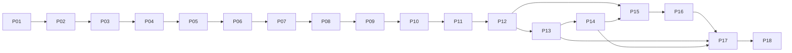

# Ambien Implementation Plan

> **製品全体の実装計画。** 承認済み [SPEC](../SPEC.md#文書の状態) を基準に P01〜P18 を mikan Issue 化した後、ユーザーは各 Issue の実装・検証・独立レビュー・指摘修正・PR 通常マージを明示的に依頼した。Cargo、固定二窓、雨の合成・標準出力・視覚境界、雨ノブ・音量・独立消音・受理通知のソースを作成した。その他の `src/`、`native/`、`resources/`、`scripts/package-app.sh` は必要な成果の開始時に追加する予定配置である。作成済みコードと実機受け入れを区別し、実際の証拠は [検証記録](verification.md)、作業状態は mikan に置く。鍵生成・認証変更・署名・公証・一般公開の権限はこの実装依頼から推定しない。
>
> **実装 AI 向け:** writing-plans の成果単位・checkbox・境界試験の考え方を使う。未導入の superpowers 実行器や worktree は必須にしない。実行フローは [AGENTS](../AGENTS.md)、[開発手順](development.md)、[Lat 運用](../lat.md/workflow.md) に従う。P01〜P18 は計画の安定参照であり、mikan ID や Status ではない。checkbox は成果の受け入れ項目であって進捗台帳ではなく、進捗は mikan のみで管理する。

**Goal:** 固定した二つの GPUI 窓から、登録された三環境の合成音・同じ世界の光・途中選択・保存・安全な更新を操作できる製品を、観測可能な成果ごとに実装する。

**Architecture:** GPUI がホスト、Ely が設定 UI、CPAL callback が世界と音を進める。声は開始前に準備し、制御・視覚の固定容量境界、非 RT worker の資源回収、保存後の終了調停を分離する。実現方法・所有・不変条件は [詳細設計](detailed-design.md)、全体の概念は [構成説明](architecture.md) を読む。

**Tech Stack:** 選定・固定改訂・最低環境は [SPEC の依存の選定](../SPEC.md#依存の選定) と [配布前提](../SPEC.md#配布前提) が唯一の正本。ソース調査はビルド・実機成功ではない。

## 全作業の制約と検証サイクル

- 数値要件・初期値・依存を本計画から決めない。入力例の数値は境界試験の fixture、容量・debounce・shutdown ramp は詳細設計の実装定数であり製品仕様ではない。音の保存例をプリセットにしない。
- [固定サイズと内部描画](../SPEC.md#固定サイズと内部描画) を全窓作業に適用する。自由 resize、zoom/fullscreen/tiling 拡大、新しい内部リサイズ操作、GPUI サイズ制御パッチは scope 外。viewport は音の制御 payload に入れない。
- 各 P は下記の固有 checklist に加え、次の共通 checklist を Issue 本文へ展開する。対象 path 以外の機能・空 Module・将来基盤・互換 shim を作らない。
  - [ ] 対象 SPEC、詳細設計の当該責務・Interface、現存 source を読み、利用者の期待と失敗時の継続対象を確認する。
  - [ ] 下記の具体入力・期待値を失敗する behavior test として先に書き、その失敗が対象規則に由来することを観測する。wiring、mock echo、ソース文言、SPEC 転記だけの試験は作らない。
  - [ ] 実経路を最小実装し、対象試験・境界・失敗注入を通す。実機 smoke を行い、推測・自動試験・実機・ユーザー判断を別々に記録する。
  - [ ] 関係する `docs/architecture.md`、`docs/verification.md`、`docs/detailed-design.md`、`docs/implementation-plan.md` と現存 Lat entry の古くなった案内だけを更新する。SPEC を変更する製品判断は先にユーザーへ戻す。
  - [ ] 必要な全体検査、独立レビュー、指摘修正、許可された PR の通常 merge、but 同期、mikan Report を [開発手順](development.md#mikan-の-issue-進行) に従って完了する。未 merge・未受入を completed にしない。
- **Rust 検査コマンド:** P01 の実在する単一 Cargo package に対して、`cargo test --locked`（当該 behavior test と package 回帰）、`cargo fmt --all -- --check`、`cargo clippy --all-targets --locked -- -D warnings`、`cargo build --locked` を用いる。期待は exit 0 と当該 assertion の成功であり、未実施を成功扱いしない。`cargo run --locked` は開発 app の smoke、`scripts/package-app.sh` は P15/P17 で作成後の署名 bundle 経路に限る。native/Sparkle が必要になると framework と認証前提も必要で、`cargo run` 単体を配布物成功にしない。
- 文書・Lat の変更後は統合担当が `npm run check:docs` を一度まとめて実行する。これは Rust、通常リンク、意味的整合、実機受け入れの証明ではない。検証結果の形式・安全な音量・停止条件は [検証手順](verification.md#安全な試行条件と中止条件) に従う。

## 予定ファイルと責務

| 予定 path | 責務／最初に必要になる P |
|---|---|
| `Cargo.toml`, `Cargo.lock`, `rust-toolchain.toml`, `src/main.rs` | 固定依存と GPUI 起動、Assets/Ely init、root 寿命／P01 |
| `src/app.rs`, `src/ui/mod.rs`, `src/ui/scene.rs`, `src/ui/settings.rs` | AppModel、窓再表示、直接 paint、controlled 設定／P01 |
| `src/platform/mod.rs`, `src/platform/macos.rs` | 借用 AppKit と OS 通知、host 置換なし／P01 |
| `src/controls.rs` | 型付き端点・revision・操作 reducer／P02 |
| `src/situations/mod.rs`, `rain.rs`, `rock.rs`, `deep.rs`, `synthesis.rs`（すべて `src/situations/` 配下） | Registry と声、固有曲線、共通固定 pool／P02・P04・P05 |
| `src/audio/mod.rs`, `render.rs`, `world.rs`, `transport.rs`, `lease.rs`, `timing.rs`, `mix.rs`（すべて `src/audio/` 配下） | worker／typed callback／論理時計／atomic 境界／所有回収／予定時刻／slerp／P02・P06 |
| `src/persistence.rs`, `src/lifecycle.rs`, `src/ui/appearance.rs` | 正規化・atomic 保存／保存後終了／OS 外観／P09・P12・P11 |
| `src/platform/updates.rs`, `native/ambien_bridge.h`, `native/ambien_bridge.m`, `build.rs` | Sparkle、protocol・block・不足終了 selector／P12・P15 |
| `resources/Info.plist`, `scripts/package-app.sh` | 実 bundle metadata と署名・公証 packaging／P15・P17 |

テストは対象の上記 Rust ファイルの `#[cfg(test)] mod tests` に置く。純粋規則はその Module、保存の real I/O は `src/persistence.rs` の隔離 tempdir、native の実経路は署名 app と [検証記録](verification.md) に置く。未作成の integration test harness や架空の tool 名を前提にしない。

## 隣接作業の共有 Interface

以下は**予定するアプリ側 API**である。GPUI/Ely/CPAL/FunDSP の実 API と混同しない。各 P の Consumes/Produces はこの表の正確な型・署名を参照する。private field や新しい forwarding trait を作業間の契約に増やさない。

| 契約 | 正確な名前・型・consumer の規則 |
|---|---|
| I01 登録 | `Registry::definitions(&self) -> &[SituationDefinition]`; `Registry::resolve(&self, id: &str) -> Option<SituationIndex>`; `Registry::knob_range(&self, index: SituationIndex) -> Range<usize>`; `Registry::prepare_voice(&self, index: SituationIndex, config: VoicePreparation) -> Result<Box<dyn Voice>, VoicePreparationError>`。`SituationDefinition` の private factory を呼び、ID 名分岐は増やさない。`SituationIndex(usize)`、`KnobIndex(usize)` の構築は境界内、文字列解決は UI/保存のみ。 |
| I02 声 | `Voice: Send`; `advance_world(&mut self, frame: VoiceFrame, knobs: &[Normalized], events: &mut VisualWriter)`; `render_sample(&mut self) -> [f32; 2]`; `set_contributing(&mut self, active: bool)`; `prepare_rate(&mut self, sample_rate: u32) -> Result<VoiceLatencyFrames, VoicePreparationError>`。`Normalized(f32)` は有限・無次元の0..1、`VoiceLatencyFrames(f64)` は有限・非負の frames。寄与0↔正の境界で固定 scalar／lazy-valid delay だけを無効化し、古い tail を再入場で復活させない。rate 再準備は worker 排他中だけ。世界の PRNG・粒寿命・息・天候は保持し、DSP 位相・残響の完全保持は保証しない。 |
| I03 操作 | `Revision(u64)`、`ControlState` は volume/mute/wander/dwell_min_minutes/dwell_max_minutes/transition_seconds、平坦 knob 配列、manual_target、manual_revision、wander_revision、settings_revision。`edit_knob(index, value)` は `KnobIndex` と `Normalized` の端点編集で手動 target を発行する reducer 操作。viewport を含まない。 |
| I04 制御配送 | `ControlMailbox::publish(&self, state: &ControlState)`; `try_read_into(&self, dst: &mut ControlState) -> bool`。全 field と sequence が atomic SeqCst。main 単一 writer/audio 単一 reader。一回読取失敗は旧整合 state 維持、spin なし。`StatusMailbox` は所有中の audio／凍結中の worker が単一 writer、main が読む。error bitset は stream epoch ごとの別 cell、worker は現在 cell だけを消費し、旧 monitor の遅延通知で新出力を止めない。 |
| I05 交差 | `GainRamp::retarget(&mut self, target: SituationIndex, duration: Duration)`; `advance_frames(&mut self, frames: usize, rate: u32)`; `gains(&self) -> &[f64]`。N 次元非負 unit vector、終端 one-hot。 |
| I06 世界 | `WorldClock` が生成 sample だけで `WorldSeconds(f64)` を進める。`Movement = Staying \| Crossing { kind: Manual \| Automatic, departure, target, start, duration }`。表示 dominant と保存 `resume_target` を別の意味で出す。 |
| I07 視覚 | `VisualEvent` は `StreamEpoch`、world 秒、CPAL 予定再生 Mach ns、`SituationIndex`、normalized x/y、strength、`radius: LogicalPixels`、shape、`lifetime: Duration`、event serial。`WorldVisualState` は同じ予定時刻と N 声の gains/breath intensity。`VisualRing::new(event_capacity, registry_count)`、`push_event(event)`、`push_state(WorldVisualState)`、`read_live_into(epoch, now, &mut preallocated_cache)`。全 slot payload atomic、sequence を再検査。 |
| I08 所有・時刻 | `EngineLease` は `UnsafeCell<Option<PreparedEngine>>` と `Owner = Idle \| Callback \| Worker` の atomic CAS、epoch ごとの別 cell と再 enable しない gate。旧 gate=false→worker 排他→engine.take 後は旧 Owner を Worker に固定し、新 cell へ engine を move→Idle→enable。旧 callback は新 cell にアクセスしない。`StreamEpoch` 内だけ CPAL と Mach 時刻を対応づけ、worker が engine を回収・準備・破棄。 |
| I09 保存 | `StateDocument` は `serde_json::Value` の unknown 保持。`LoadedState`、`LoadOutcome = Loaded { settings, document, write_policy } \| Defaults { reason, document, write_policy }`。`SaveWorker` の pending 最新1＋in-flight1、`SaveReceipt = { revision, result }`。flush は最新 revision の置換成功 receipt を待つ。 |
| I10 終了 | `TerminationCoordinator::request(reason: NormalQuit \| UpdateInstall) -> AttemptId`。最新 ack と `resume_target` で snapshot 確定、保存成功→shutdown gain→予定 playback deadline→quit/restart。古い `AttemptId` を採用しない。 |
| I11 host/UI/native | `AppModel`、`SceneView`、`SettingsView`、`VisibleParticles`、`AudioController` は詳細設計の所有単位。main root が Entity/Subscription/Task と platform/update owner を保持。借用 `NSWindow` は main 同期 closure 内だけ。Sparkle reply/block は同じ `AttemptId` と I10 に合流し一度だけ呼ぶ。 |

### consumer-facing の実装例

これは境界の規則を示す部分例であり、全 app の仮実装ではない。定数・準備・private helper は該当 P が実装する。

```rust
// P03: callback 境界。read は一回だけ。読取失敗で音を止めない。
if mailbox.try_read_into(&mut read_scratch) {
    std::mem::swap(&mut controls, &mut read_scratch); // 両方開始前に確保
    // manual_revision が前回と異なる時だけ P06 の retarget を実施。
    // volume/mute は controls の最新端点を独立して適用する。
}
```

```rust
// P06 の利用者規則を固定する test 例（test helper は同ファイル内）。
let before = ramp.gains().to_vec(); // test の確保。callback 内で行わない。
let target = fixture_registry.resolve("deep").expect("registered fixture");
ramp.retarget(target, manual_duration_from_spec);
assert_eq!(ramp.gains(), before.as_slice());
ramp.advance_frames(duration_frames, test_rate);
assert_eq!(ramp.gains(), &[0.0, 0.0, 1.0]);
// 途中各点で nonnegative、sum(g*g)≈1、前後 sample の連続性を別 assertion。
```

```text
P09/P12 flush consumer:
 latest snapshot revision = r
 submit(snapshot[r]); flush(r)
 receipt(r-1, Ok)       → 終了を進めない
 receipt(r, Err(reason)) → 今回の AttemptId を取消、音と通常操作を維持
 receipt(r, Ok)          → 同じ AttemptId だけ shutdown fade 開始
 古い AttemptId の fade 完了 → リソース回収だけ、quit/restart しない
```

```text
P08 placement consumer:
 x = normalized_x * current_viewport.width
 y = normalized_y * current_viewport.height
 radius = LogicalPixels のまま（width/height 比、Retina 倍率を再乗算しない）
 viewport が空/zero/nonfinite → paint を休む。世界・audio・control revision は不変。
 event.present_ns > now → cache に保持して待つ。生成直後に光らせない。
 event.epoch != active_epoch → 破棄。hidden の過去イベントを再生しない。
```

## 依存 DAG



線は必要成果の依存であり着手許可ではない。P13 はユーザー試聴、P14 は環境・認証・公開先準備、P16 は署名版 Sparkle 統合 gate、P17/P18 は配布・実機受け入れを含む。これらを AI の test 成功だけで completed にしない。

## P01 固定したシーンと設定の実窓を操作できる

**DependsOn:** なし。**SPEC:** [窓](../SPEC.md#窓)、[固定サイズと内部描画](../SPEC.md#固定サイズと内部描画)、[基盤のサイズ制約と既知のコスト](../SPEC.md#基盤のサイズ制約と既知のコスト)、[メニュー](../SPEC.md#メニュー)、[設定窓](../SPEC.md#設定窓)、[依存](../SPEC.md#依存の選定)。

**Files:** Create `Cargo.toml`, `Cargo.lock`, `rust-toolchain.toml`, `src/main.rs`, `src/app.rs`, `src/ui/mod.rs`, `src/ui/scene.rs`, `src/ui/settings.rs`, `src/platform/mod.rs`, `src/platform/macos.rs`。Test: `src/platform/macos.rs` 内の geometry tests。文書更新は共通 checklist の paths。

**Consumes:** I11 の GPUI host と借用 AppKit 規則、SPEC の固定基準。**Produces:** I11 `AppModel`/`SceneView`/`SettingsView` の実 Entity と close/reopen 所有、固定窓 Adapter。音はこの P の成果ではなく、fake 音や未実装 controls を成功に見せない。

- [ ] Cargo と実際の二窓を同時に作る。`gpui_platform::application().with_assets(Assets).with_quit_mode(QuitMode::Explicit).run(...)` 内で `ely::init(cx)`、root を保持する。scaffold 単体で終えない。
- [ ] blur/透明 titlebar/信号ボタン/空白 drag、scene close handle clear、設定前面化、⌘, と明示 quit を接続する。
- [ ] `WindowBounds::Windowed`、titlebar Some、`is_resizable=false`、`show=false/focus=false` で生成する。open 前に `NSWindow::contentRectForFrameRect_styleMask` で実 workarea outer→content を変換して初回寸法を補正する（open 内の初回 renderer 確保より前）。Adapter 設定後 `activate_window` で表示する。
- [ ] `HasWindowHandle::window_handle(window)`→`NSView.window` を同期借用する。collectionBehavior の FullScreenPrimary/Auxiliary/AllowsTiling だけ除き FullScreenNone/FullScreenDisallowsTiling を追加、他 bits 保持。ZoomButton 無効、contentMinSize/contentMaxSize は同じ補正済み固定 content。delegate を置換せず位置の手動移動は残す。screen 取得不能は最後の有限値を維持する。
- [ ] Cargo の feature 候補は gpui default-features=false/stacker、gpui_platform default-features=false/font-kit、Ely default-features=false/runtime_shaders とする。native 通知は async-channel、借用 Adapter は objc2/objc2-app-kit/objc2-foundation/raw-window-handle/block2 の固定ソースと既存依存解決に合わせ、実使用に必要な features だけを lock する。具体候補と改訂は [詳細設計の固定窓](detailed-design.md#固定gpui窓とely設定) に従い、候補を build 成功としない。
- [ ] desktop edge/Option/menu/keyboard tiling の全経路で content 不変を実機受け入れする。FullScreenDisallowsTiling を desktop tiling 全体無効化の source 保証にしない。不成立なら停止し、未承認 delegate/renderer 修正を追加しない。

P01 で採る直接依存の具体候補（製品依存の正本は SPEC、解決結果は作成する Cargo.lock）:

```toml
async-channel = "=2.5.0" # 非RTのnative→main通知だけ
objc2 = "=0.6.4"
raw-window-handle = "=0.6.2"
block2 = "=0.6.2"
objc2-app-kit = { version = "=0.3.2", default-features = false, features = ["std", "NSAccessibility", "NSButton", "NSControl", "NSResponder", "NSScreen", "NSView", "NSWindow", "NSWorkspace", "objc2-core-foundation"] }
objc2-foundation = { version = "=0.3.2", default-features = false, features = ["std", "NSArray", "NSDictionary", "NSGeometry", "NSNotification", "NSObject", "NSOperation", "NSString", "block2", "objc2-core-foundation"] }
```

macOS 直接依存は Cargo の target macOS section に閉じる。P15/P16 が ObjC 側で Sparkle agent を扱う場合、Rust の NSRunningApplication/NSBundle features を先行追加しない。両参照プロジェクトの lock 完全一致を主張しない。Zed/Ely の固定 source と ABI/feature の成立を実 build で確認し、解決不成立は依存差替えの許可ではなく停止条件である。

**Behavior tests:** 基準 content と狭い有限 workarea 入力→外枠が内側・content 正値、zero/取得不能→既知有限制約保持、frame/content 往復→同じ左上（浮動小数誤差範囲）。fake NSWindow 呼出回数ではなく変換結果を検査する。

**Smoke/受入:** 起動し両窓を見る。scene 空白 drag、閉じる→「シーンを表示」、設定を二度開く→同一窓前面、設定 close→app 継続、⌘Q→終了。resize/zoom/fullscreen/tiling 拡大が提供されないこと、blur の空白透明性を観測。固定依存の build/ABI や固定制約が成立しなければ停止し、AppKit 別 host や GPUI patch に逃げない。

## P02 雨の音と同じ粒の光を実標準出力へ出す

**DependsOn:** P01。**SPEC:** [音と絵](../SPEC.md#音と絵)、[視覚イベント](../SPEC.md#視覚イベント)、[再生予定時刻](../SPEC.md#再生予定時刻)、[シチュエーション](../SPEC.md#シチュエーション)、[初期のシチュエーションとノブ](../SPEC.md#初期のシチュエーションとノブ)、[スレッドと資源](../SPEC.md#スレッドと資源)。

**Files:** Create `src/controls.rs`, `src/situations/mod.rs`, `src/situations/rain.rs`, `src/situations/synthesis.rs`, `src/audio/mod.rs`, `src/audio/render.rs`, `src/audio/world.rs`, `src/audio/transport.rs`, `src/audio/lease.rs`, `src/audio/timing.rs`; Modify `src/main.rs`, `src/app.rs`, `src/ui/scene.rs`, `src/ui/settings.rs`, `Cargo.toml`, `Cargo.lock`。Behavior tests は制御境界、雨・共有合成、実 typed callback、lease、atomic transport、世界・予定時刻、シーンの凍結キャッシュに置く。`src/rt_alloc.rs` は `cfg(test)` 専用の thread-local Rust allocator 観測器であり、実 callback／固定 pool の試験区間だけ確保・再確保・解放を数える。native backend 全体の測定器ではない。

**Consumes:** I11 の実 host。**Produces:** I01 `Registry`/`SituationDefinition`/`KnobDefinition`/`VoicePreparation`、I02 `Voice`/`VisualWriter`、I03 `ControlState`、I04 mailbox 境界、I06 `WorldClock`、I07 `VisualEvent`/`WorldVisualState`/`VisualRing`、I08 `PreparedEngine`/`EngineLease`/`StreamEpoch`、I11 `AudioController` の雨 E2E。

現存の source は上記の経路を接続している。設定窓は出力状態と候補の説明表示までで、操作は P03。現行環境の外部 native E2E と雨のユーザー確認を、コード作成・自動試験・標準 stream・境界試験の証拠と区別して [検証記録](verification.md#p02-雨の標準出力と視覚境界の限定検証) に記録する。非可視・ロック中の過去の失敗を成功に書き換えず、三環境の音質・初期値確定、物理同期、native backend 全体の RT・最悪負荷へ一般化しない。作業状態・統合結果は mikan Report で確認する。

- [ ] worker で標準 Device の config、声、固定 pool、DSP、atomic arrays/scratch を準備し build/play を行う。default Device を HalOutput として再列挙しない。BufferSize は Default。
- [ ] 雨連続成分・近い粒・独立風を noise/pink/filter と短い包絡、Poisson、帯域制限した色付き揺らぎで合成する。FunDSP は準備後 `tick` のみ。composite `process` の未初期化経路、Slot/Net/Sequencer の callback 差替えは採らない。
- [ ] `set_sample_rate`/allocate/reset と dry 因果遅延 metadata を worker で準備する。残響は詳細設計の `RestartableReverb`（4 comb＋2 allpass／channel、lazy-valid fixed delay）、寄与境界は I02 `set_contributing` で固定 scalar 状態だけ再開始する。FDN 全体 reset／大規模 clear を RT に置かない。粒 pool 満杯は新規音粒採用停止、視覚 overflow は音を止めない。
- [ ] f32/i16 の typed callback、可変 `data.len()/channels`、mono `(L+R)/2`、stereo L/R、多 channel は先頭 L/R 以外 silence を実装する。unsupported config は明示出力失敗として UI を維持する。
- [ ] engine 単発 CAS と永続 epoch gate を最初から実装し、worldevent の x を pan と光へ共用、Mach 予定時刻で直接 canvas paint する。仮の試聴 candidate を確定 default と呼ばない。
- [ ] epoch ごと別 cell を用い、旧 Engine.take 後は旧 Owner=Worker 固定、新 cell に engine move→Idle→enable。旧 callback が新 cell CAS を奪わず無音 gap を作らない interleaving を試験する。audio callback で async-channel send/try_send は使わない。
- [ ] error callback は epoch 専用 cell の固定 atomic bitset だけを更新し、worker は現在 cell だけを消費する。旧 cell の遅延 DeviceChanged 等が新出力・新世界を変えない境界を試験する。

**Behavior tests:** amount=0/wind>0→新雨発生と雨連続成分 zero、風は残る；wind=0/amount>0→雨は残る。端点を有限時間で zero にし残響は自然に終える。可変 frame fixture 1/127/513、channel 1/2/6、f32/i16→有限出力と規定 channel mapping。pool 満杯→占有数が増えず visual overflow と独立。旧 gate disabled callback→無音・WorldSeconds 不変、Worker 所有中→callback は待たない。予定 playback＋frame offset＋dry delay の fixture→対応 ns。

**Smoke/失敗:** 実標準出力の雨と同じ左右の光を観測。scene close→音継続。無出力→失敗表示・設定窓維持。安全な音量で試聴候補を記録する。FunDSP 使用ノードの有限性/RT または CPAL timestamp 対応が成立しなければ停止し、録音や生成時刻の即時表示で代用しない。

## P03 雨ノブ・音量・消音を設定とメニューで一致させる

**DependsOn:** P02。**SPEC:** [体験](../SPEC.md#体験)、[設定窓](../SPEC.md#設定窓)、[ボリューム設定](../SPEC.md#ボリューム設定)、[スレッドと資源](../SPEC.md#スレッドと資源)。

**Files:** Modify `src/controls.rs`, `src/ui/settings.rs`, `src/app.rs`, `src/audio/transport.rs`, `src/audio/render.rs`。Tests: `controls.rs`, `transport.rs`, `render.rs` 内。

**Consumes:** I01 knob metadata、I03 `ControlState`、I04 `ControlMailbox`、I02 voice。**Produces:** I03 revision reducer と `edit_knob(KnobIndex, Normalized)` 規則、I04 coherent publish/read、I11 controlled UI と status 表示。

- [ ] Ely Slider/Switch/SegmentedControl を metadata と stable id で controlled 化する。Slider/Switch は processor、segment は listener/Entity update。設定 viewport を状態編集にしない。
- [ ] manual revision と volume/mute/wander/settings revision の意味を分離する。knob 編集は wander=false と編集対象への最新 manual intent。
- [ ] atomic SeqCst odd/payload/even で publish、一回 before/payload/after の一致 even だけ採用する。非 atomic payload の seqlock を使わない。
- [ ] mix 後に独立 volume smoothing/mute を適用し zero endpoint を有限時間で確定する。mute 中も world と視覚を進める。
- [ ] main への通知は output/dominant/control receipt/失敗の離散変更だけにする。gain/breath の視覚更新で設定窓を常時 notify しない。callback から async-channel に送らず、固定 status 境界を非 RT 側が読む。

**Behavior tests:** mute=true→volume 0.8 へ変更→mute 維持；volume=0→生成 world/event 時刻進行、出力 zero；knob 編集→manual_revision 増加・wander=false・target が knob owner。窓閲覧/volume/time→manual_revision 不変。publish 中各 interleaving→mixed state を採用せず旧整合 snapshot、latest volume/mute を古い intent で上書きしない。

**Smoke/失敗:** 雨ノブ、音量、menu mute を交互操作し menu/設定一致、mute 中光と時間継続、解除後最新音量。操作途中の focus が viewport 更新で失われない。読取衝突は一 callback 旧 state 維持だけで音停止や spin を起こさない。

現存経路は `ControlEdit` の latest-state reducer、metadata／stable id の Ely フォームと checked menu mute、全 numeric SeqCst の受理 mailbox、`PreparedEngine` の独立した出力 ramp と凍結中の受理、worker の離散通知である。実標準 stream・自動試験と外部 native controls／lifecycle の成功は [検証記録](verification.md) を参照する。設定操作・受理・menu一致・focus保持・再生成と終了は実観測済み。ユーザーの画面収録許可後の初回visualは3枚目前のfocus喪失で失敗したが、ガードを維持し追加観測を持つ1回の限定診断では、所有実窓PNG3枚・隣接2比較・実menu Quit正常exit0まで成功した。最初の喪失原因は未特定のまま保持し、画像差分を粒だけの運動や可聴無音の証明にしない。消音中の80%→20%変更で無音を維持し、解除後は最後の20%程度で鳴ることは、別のユーザー聴感確認で受け入れた。撮影権限の成功をケース全体の成功にせず、focus guardや必要な実行前提を省かない。時間 UI・自動移動・保存・終了 fade は先行実装しない。

## P04 岩の音・ノブ・衝突光を登録する

**DependsOn:** P03。**SPEC:** [シチュエーション](../SPEC.md#シチュエーション)、[初期のシチュエーションとノブ](../SPEC.md#初期のシチュエーションとノブ)。

**Files:** Create `src/situations/rock.rs`; Modify `src/situations/mod.rs`, `src/situations/synthesis.rs`（同じ理由で共用できる合成だけ）。Tests: `rock.rs`/`synthesis.rs` 内。

**Consumes:** I01 registry、I02 `Voice`/`VoiceFrame`/`Normalized`/`VisualWriter`、I07 event metadata。**Produces:** 同じ I01/I02 の rock 定義と声。UI/audio/保存に rock 名分岐を追加しない。

- [ ] module と登録一行で knob 順序・曲線・衝突 shape を提供する。
- [ ] 固定衝突 pool、低い共鳴、転がりを準備する。`resonator_hz` 第二引数は bandwidth ではなく実装 Q として center/bandwidth から変換、dcblock と残響を準備する。
- [ ] amount zero の新規停止と既存余韻、size/hardness 独立、hardness 上端の peak を有限性と wave 統計で調整する。

**Behavior tests:** amount 1→0→smoother endpoint 後に新規 collision count 不増、既存 envelope は減衰；size=0→最小の岩で無音にしない；hardness 0/1 と rate 変更→finite samples/Q、固定 pool 上限維持。registry resolve("rock")→登録 index、unknown→None。

**Smoke/失敗:** 設定/menu に metadata から岩が現れ、柔らかさ・大きさ・衝突光が変わる。極端 knob の不意な peak は停止して記録し、安全な範囲へ規則を修正する。試聴未確定値は candidate のまま。

## P05 深海の低い響き・気泡・遅い光を登録する

**DependsOn:** P04。**SPEC:** [シチュエーション](../SPEC.md#シチュエーション)、[初期のシチュエーションとノブ](../SPEC.md#初期のシチュエーションとノブ)、[視覚イベント](../SPEC.md#視覚イベント)。

**Files:** Create `src/situations/deep.rs`; Modify `src/situations/mod.rs`, `src/situations/synthesis.rs`（必要な共通 primitive のみ）。Tests: `deep.rs` 内。

**Consumes:** I01/I02/I07 の同じ型。**Produces:** deep の `SituationDefinition`/`KnobDefinition` と `Box<dyn Voice>`。後続 consumer の型を変えない。

- [ ] depth の filter/暗さ/遅さ曲線と air の気泡頻度・高域曲線を別にする。
- [ ] 準備済み低い合成響きと固定 bubble pool、暗い青の遅い光を module＋登録一行で追加する。
- [ ] air endpoint zero では気泡のみ停止し、低い響きを維持する。天候を knob 範囲内に閉じる。

**Behavior tests:** air=0→新規 bubble zero/低域 nonzero；depth=0→finite nonzero 浅い音；両端と大幅変更→finite 出力/範囲逸脱なし；registry 総 knob range は重複なく rain/rock/deep の順序に従う。

**Smoke/失敗:** 三環境が選べ、深海の air zero でも低い響きが残り、光が独自形を乱数生成していないことをイベント記録と観測で確認する。ここで三環境の品質合格を宣言しない。

## P06 現在の多声混合から手動選択へ滑らかに寄せる

**DependsOn:** P05。**SPEC:** [切り替えと途中操作](../SPEC.md#切り替えと途中操作)、[体験](../SPEC.md#体験)、[設定窓](../SPEC.md#設定窓)。

**Files:** Create `src/audio/mix.rs`; Modify `src/audio/world.rs`, `src/audio/render.rs`, `src/controls.rs`, `src/ui/settings.rs`, `src/app.rs`。Tests: `mix.rs`, `world.rs`, `render.rs` 内。

**Consumes:** I03 manual_target/revision、I01 registered N、I02 prepared voices。**Produces:** I05 `GainRamp` 全署名、I06 manual `Movement` と `resume_target`、I07 gains、I11 手動対象の即時表示。

- [ ] g0/current arrays を N で開始前確保し、現在 vector→target の非負 unit slerp を retarget する。同じ revision を再適用しない。
- [ ] 数学式の `theta=acos(g0[target])` は詳細設計の安定な同値計算 `s=hypot(non-target成分)`、`theta=atan2(s,g0[target])` と接平面で実装する。`s==0` だけを不要交差とし、近い target の正の微小寄与を先に捨てない。retarget 時に cosΔ/sinΔ を準備して sample ごとは rotation recurrence、区間境界で誤差補正、終端 one-hot とする。
- [ ] 第三声も現在 vector から直ちに加え、最新選択で上書きする。volume/mute と shutdown gain を交差から分離する。

**Behavior tests:** [1,0,0]→rock 途中で deep→retarget 直前直後 vector 同一、指定 duration 後 [0,0,1]；連続1000 retarget→nonnegative/Σg²≈1/最後だけ one-hot；[1,1e-20,0] のように target が1へ丸められても非targetが正→不要交差にせず duration 後に正確な one-hot；[0,1,0]→rock→不要交差なし；already-playing rock→現在 mix から rock 単独；rate 変更→残り秒保持。実 DSP に impulse→離脱→長い非寄与→zero inputで再選択→旧 tail なし、その後の新 impulse→規定 delay のみ。世界 PRNG／粒年齢は保持、同じ active 値の反復は不変、mute は履歴を無効化しない。誤差 tolerance は数値演算の検査値として test に明示し聴感保証にしない。

**Smoke/失敗:** 三環境を短く連打、二声途中に第三声、mute 中選択→解除で最新対象、menu/設定同挙動を耳と光で観測。最大三声実 callback の allocation/drop/wait/I/O を診断する。unit norm は相関 waveform の peak 保証ではなく不意な音量増加は別観測・修正する。

## P07 自動移動と時間設定の次回適用を実装する

**DependsOn:** P06。**SPEC:** [体験](../SPEC.md#体験)、[時間設定](../SPEC.md#時間設定)、[設定窓](../SPEC.md#設定窓)、[保存](../SPEC.md#保存)。

**Files:** Modify `src/audio/world.rs`, `src/controls.rs`, `src/ui/settings.rs`, `src/app.rs`。Tests: `world.rs`, `controls.rs` 内。保存 consumer は I06 出力を使う予定であり、空 `persistence.rs` は作らない。

**Consumes:** I05 gains、I03 wander/time revisions、I01 registered N。**Produces:** I06 Staying/Automatic Crossing、arrival 基準 dwell、display dominant と `resume_target`、I07 world state。

- [ ] 現在を除く index 集合の一様抽選と min-inclusive/max-exclusive dwell、min=max fixed を PRNG 注入可能な純粋規則にする。rejection sampling は CPAL callback 全体で最大8回、拒否継続なら Staying の private pending draw を次 callback へ持ち越す。scratch chunk／sample で上限を再開せず、wander off／manual intent で取消し、偏った fallback を使わない。
- [ ] on/off の Staying/Crossing 両分岐と、時間編集の次回抽選/次回自動交差への適用を実装する。
- [ ] 同率 display は以前、auto 保存は departure、manual は最新 target を別に出す。UI に SPEC の次回適用説明と対の time slider 補正を置く。

**Behavior tests:** N=1→自動交差なし；N=3/current=1、抽選境界0/最大→1以外の各 index；N=4/current=1、u64 threshold=1 の拒否値0を8回→その callback は8試行だけで Staying 維持、次 callback の値1→target2 へ交差；pending中 wander off／manual→自動抽選取消。min=max=7分→常に7分；arrival 前に滞在 timer が進まない。Staying on→今から新抽選、Crossing off→予定 arrival まで完了、Crossing on→arrival から抽選。待ち残り17秒で時間変更→17秒保持；自動 cross 途中変更→その duration 保持。min 20/max 10 保存入力は P09 で交換、UI min を max 超え→両者同値。

**Smoke/失敗:** 短い許可時間設定で実 UI の on/off・次回適用・選択表示を観測し virtual time と実時計を区別する。volume/time 編集だけで wander が外れない。乱数試験の有限回数を完全な一様性の実証にしない。

## P08 予定表示・容量・非表示復帰を完成する

**DependsOn:** P07。**SPEC:** [視覚イベント](../SPEC.md#視覚イベント)、[再生予定時刻](../SPEC.md#再生予定時刻)、[窓](../SPEC.md#窓)、[高DPIと描画負荷](../SPEC.md#高dpiと描画負荷)。

**Files:** Modify `src/audio/timing.rs`, `src/audio/transport.rs`, `src/audio/render.rs`, `src/ui/scene.rs`, `src/ui/mod.rs`。Tests: `timing.rs`, `transport.rs`, `scene.rs` 内。

**Consumes:** I07 events/state、I08 active epoch、I11 visibility。**Produces:** I07 `read_live_into` と固定 history の時刻選択/補間、I11 `VisibleParticles` と可視 scene のみ Task。

- [ ] CPAL playback と Mach monotonic ns を epoch 内で対応づけ、frame offset/dry delay を反映する。未来 state/event は現在に前倒ししない。
- [ ] 上書き可能 atomic slots と sequence/global serial、期限切れ→弱い順の表示省略、旧 epoch clear を実装する。producer が reader を待たない。
- [ ] 可視時だけ timer Task を保持し SPEC の maxfps を notify で制限、完全 occlusion/minimize/close で停止する。settings を同 Task にしない。
- [ ] 最新 viewport へ normalized 配置、論理 radius と clip を使う。state cadence は視覚更新/phase 変更、全 sample 状態 queue を作らない。

**Behavior tests:** event present=100、now=99→非表示、now=100→表示；lifetime 終了→非表示；epoch 変更→旧 event zero。reader 停止して容量超過 publish→producer 継続、live のみ復帰。slot 読取中書換→視覚だけ省略。state t=10/20 の gains を t=15 へ補間、future を先取りしない。viewport 0→paint zero/音 world 不変、normalized(.25,.75)→現在領域の同割合、円 radius 不変。音 pool 満杯、visual ring 満杯、表示 cache 満杯を別 test にする。

**Smoke/失敗:** 隠す/最小化/閉じる→音と wander 継続・scene animation 停止、再表示→古い粒一斉発光なし、mute 中視覚継続。予定 deadline 記録と実内蔵/有線・Bluetooth の物理観測を分ける。latency query/WindowServer/BT 誤差は P18 gate、生成時刻だけで合格にしない。

## P09 設定を保存・復元し壊れた元ファイルを守る

**DependsOn:** P08。**SPEC:** [保存](../SPEC.md#保存)、[ボリューム設定](../SPEC.md#ボリューム設定)、[時間設定](../SPEC.md#時間設定)。

**Files:** Create `src/persistence.rs`; Modify `src/app.rs`, `src/controls.rs`, `src/ui/settings.rs`, `Cargo.toml`, `Cargo.lock`（保存の必要依存のみ）。Tests: `persistence.rs` の real tempdir I/O と `controls.rs` 内。

**Consumes:** I01 metadata/default candidates、I03 endpoints、I06 `resume_target`、I11 settled window state。**Produces:** I09 `StateDocument`/`LoadedState`/`LoadOutcome`/`SaveWorker`/`SaveReceipt` と write policy。

- [ ] raw JSON Value の unknown を残し known fields だけ clamp/round/交換、missing default、unregistered last は先頭に解決する。
- [ ] future version は defaults 起動＋明示失敗＋元 read-only、corrupt/unreadable は一意 backup rename、backup 不能は read-only にする。余分な migration を作らない。
- [ ] debounce と latest pending1/in-flight1 の直列 worker、同 directory temp→write_all→sync_all→rename→parent sync を実装し receipt を返す。
- [ ] 通常保存失敗は menu/設定に表示し音を維持する。flush は latest revision の成功だけ認める。

**Behavior tests:** volume=-1/2→両端、known knob 範囲外→端、missing knob→module default；min20/max10→10/20、非整数 time→SPEC の単位へ丸める。unknown situation/外した knob/nested unknown→往復保持；last="missing"→先頭。future version→元 bytes 不変；invalid JSON→backup と defaults；backup rename 拒否→元不変/保存 failure。temp write/sync/rename 各失敗→置換前に old file を失わない。rename後の directory sync 失敗→新 bytes は既に置換済みだが durability 未確認、成功 receipt なし、旧 bytes に戻ったと表示しない。r1 in-flight に r2/r3 submit→pending r3 のみ、r1 receipt で flush(r3) を解除しない。

**Smoke/失敗:** 実 app で knob/volume/mute/time と位置を変え、落ち着いた後終了→再起動で端点復元。隔離した実 state で破損/書込不能→説明表示・音継続・元保護を観測。ユーザーの通常 state を破壊して失敗注入しない。

## P10 sleep・標準出力復旧で世界の残りから再開する

**DependsOn:** P09。**SPEC:** [消音・スリープ・出力停止](../SPEC.md#消音スリープ出力停止)、[再生予定時刻](../SPEC.md#再生予定時刻)、[スレッドと資源](../SPEC.md#スレッドと資源)。

**Files:** Modify `src/audio/mod.rs`, `src/audio/lease.rs`, `src/audio/timing.rs`, `src/audio/world.rs`, `src/audio/render.rs`, `src/platform/macos.rs`, `src/app.rs`。Tests: `lease.rs`, `world.rs`, `timing.rs` 内。

**Consumes:** I08 lease/epoch、I06 logical seconds/remaining state、I03 mute、I04 status。**Produces:** I11 `AudioController` recovery と worker checkpoint、I08 新 epoch での再準備。

- [ ] stream 外に OS device property listener と sleep/wake 通知を保持する。error callback は epoch ごとの別 bitset cell へ固定 code を公開し、worker は現在 cell だけを処理する。旧 monitor の遅延 DeviceChanged/StreamInvalidated で復旧済み stream を止めない。
- [ ] enabled=false→worker の Idle→Worker 単発取得を非 RT で待ち→checkpoint/engine take を行う。pause/drop/最後 callback を回収証明にしない。
- [ ] reroute と rebuild を区別し、rate/config 変更は worker 排他中に I02 `prepare_rate` で再準備する。論理残り秒・世界の PRNG/粒寿命/息/天候・mute を保持し、旧 frame 数を新 rate と読み替えない。返す `VoiceLatencyFrames` は新 rate で予定再生時刻へ変換する。失敗は Frozen と明示出力失敗を維持し、未知遅延を 0 にしない。
- [ ] 旧 gate を永久 disabled にし worker が engine.take した旧 cell は Owner=Worker 固定で封じる。別の新 epoch cell へ engine を move/install→Idle→enable し、復旧 gain を滑らかに戻す。旧 callback が新 cell の CAS を取得できないことと、新 callback に旧 closure が作る無音 gap がないことを interleaving test に追加する。

**Behavior tests:** callback CAS 前/後に disable を挟む interleaving→worker と callback が同時 borrow しない、旧 closure 遅延呼出→無音/world 不変、旧 error cell の遅延 DeviceChanged→新 epoch と正常出力不変。rate48k→44.1k、cross 残り1.25秒→新 rate でも残り1.25秒；sleep 壁時計1時間→world delta0；mute=true→復旧後 true。engine/DSP drop が worker、closure 遅延寿命でも engine を回収できる。

**Smoke/失敗:** 安全な環境で sleep/wake、標準出力の抜差しと切替→最後の状態静止・UI 操作可・復旧から残り再開。スピーカーへ鳴り得る注意を守る。CPAL inner monitor/closure 資源寿命は実 lockfile と失敗注入で独立診断し、アプリ lease の証明を依存内部の無漏れ証明にしない。

## P11 窓位置・画面収まり・外観・アクセシビリティを完成する

**DependsOn:** P10。**SPEC:** [固定サイズと内部描画](../SPEC.md#固定サイズと内部描画)、[高DPIと描画負荷](../SPEC.md#高dpiと描画負荷)、[基盤のサイズ制約と既知のコスト](../SPEC.md#基盤のサイズ制約と既知のコスト)、[復元](../SPEC.md#復元)、[アクセシビリティ](../SPEC.md#アクセシビリティ)。

**Files:** Create `src/ui/appearance.rs`; Modify `src/platform/macos.rs`, `src/persistence.rs`, `src/app.rs`, `src/ui/scene.rs`, `src/ui/settings.rs`。Tests: `macos.rs`, `appearance.rs`, `scene.rs` 内。

**Consumes:** I09 saved window、I11 borrowed NSWindow/main notifications、I07 normalized event。**Produces:** I11 fixed fit/restore、system palette、GPUI/Ely/scene の三つの motion 反映、settled 保存矩形。

- [ ] UUID で screen を選び relative 外枠 top-left→global bottom-left を変換する。saved width/height は自由寸法として採らず現在の固定基準を fit する。
- [ ] missing screen/画面外/過大値を利用可能 workarea へ補正、screen 一時取得不能は最後の有限寸法を保持、移動通知ごとに保存しない。
- [ ] workspace 自身の notificationCenter を observe する。native observer は `async_channel::bounded::<()>(1)` の Sender だけ capture、try_send の Full は最新再読込を coalesce、Closed は終了済み。Send block に AsyncApp/ForegroundExecutor/NSView raw を capture しない。
- [ ] root 所有の foreground `cx.spawn` Task が recv().await→AsyncApp::update→App::defer→WeakEntity::update で最新 native state を読み反映する。古い notification pointer/画面寸法を queue 化せず同期 callback で App.update しない。system appearance→Theme mode、reduce motion→GPUI/Ely/scene、reduce transparency→例外背景を別適用する。
- [ ] 閉窓で window observer を解除し、global workspace observer は app owner が保持。shutdown は observer 解除→channel close→Task drop、Task detach 禁止。Retained token の drop だけで NotificationCenter 解除済みとしない。連続通知→pending1/最新状態適用、閉窓通知→破棄/借用なし、終了後通知→Closed の境界を試験する。
- [ ] stable id と設定 scroll を維持し、光の円/論理 radius/clip を最新 viewport へ置く。倍率変化を音再初期化にしない。

**Behavior tests:** 存在しない UUID/画面外 x/y/巨大 saved dimensions→現在 workarea に fixed 基準を補正；global negative-origin screen で外枠 left-top 往復；screen None→有限既知値。reduce motion on→漂いなし/柔らかな明滅・audio state 不変；transparency on→不透明、off→blur 空白透明。viewport 更新→manual/settings revision 不変・同 normalized 粒・count 不増。

**Smoke/失敗:** 対応する実 screen/DPI へ移動、倍率変更、狭い workarea、保存 screen を外して復元、設定 scroll/focus を観測。起動時と稼働中の light/dark/motion/transparency 切替を両窓で確認。実 Metal surfaces/intermediate/MSAA/atlas/WindowServer/旧資源の寿命を区別して測る。未観測 screen は対応済みとしない。GPUI 再確保前を通知後 Adapter で防げると説明しない。

## P12 保存と fade が成功してから通常終了する

**DependsOn:** P11。**SPEC:** [保存](../SPEC.md#保存)、[メニュー](../SPEC.md#メニュー)、[配布と更新](../SPEC.md#配布と更新)、[スレッドと資源](../SPEC.md#スレッドと資源)。

**Files:** Create `src/lifecycle.rs`, `native/ambien_bridge.h`, `native/ambien_bridge.m`, `build.rs`; Modify `src/app.rs`, `src/audio/render.rs`, `src/audio/timing.rs`, `src/persistence.rs`, `src/platform/macos.rs`, `Cargo.toml`, `Cargo.lock`。Tests: `lifecycle.rs`, `persistence.rs`, `render.rs` 内。

**Consumes:** I09 receipts、I06 ack/`resume_target`、I08 frozen lease/予定時刻。**Produces:** I10 coordinator/`AttemptId`、I11 additive native termination gate と shutdown gain。

- [ ] quit/menu/⌘Q と OS 終了を同じ Coordinator に合流する。保存中は設定 edit を止め最終端点を flush、成功前には fade/quit しない。
- [ ] 正常保存 receipt 後だけ独立 shutdown gain を開始し、最終 sample の予定 playback deadline まで stream を保持する。無出力/sleep は凍結 state を根拠に fade 待ちなし。
- [ ] GPUIApplicationDelegate に終了 selector がないことを確認し `class_addMethod` で不足 selector のみ追加する。既存実装置換/swizzling/delegate replace は禁止、失敗は integration failure。
- [ ] 保存失敗はその intent を cancel し通常操作・音を維持、古い receipt/fade result は AttemptId で無効化して回収する。

**Behavior tests:** r 最新 snapshot、r-1成功→fadeなし；r失敗→quitなし/edit復帰/音維持；r成功→fade→deadline 前 quitなし/到達後一度。Attempt A 取消後 A 完了が届く→B の状態/quit 不変。manual cross→last 最新 target；auto 同率→departure；auto unequal→dominant。frozen/無出力→hang なし。

**Smoke/失敗:** 実 quit→再起動、手動/自動 cross 中 quit→指定側 endpoint から復元。保存不能の隔離状態で quit→app 生存・音継続・失敗表示。OS termination も同じ gate を通る。selector ABI/GPUI delegate 統合が成立しなければ停止し直接終了に抜けない。

## P13 三環境の試聴で初期ノブ・聞こえる大きさを確定する

**DependsOn:** P12。**SPEC:** [成功条件](../SPEC.md#成功条件)、[初期のシチュエーションとノブ](../SPEC.md#初期のシチュエーションとノブ)、[音と操作](../SPEC.md#音と操作)。

**Files:** Modify `src/situations/rain.rs`, `src/situations/rock.rs`, `src/situations/deep.rs`, `src/situations/synthesis.rs`, `SPEC.md`（ユーザー承認した確定初期値だけ）, `docs/verification.md`。Tests は各 situation 内。

**Consumes:** I01 `KnobDefinition` の candidate、I02 実 wave と三声、I05 実交差。**Produces:** 同じ I01/I02 型の試聴承認された初期値・曲線/音量校正、SPEC に確定値、環境付きユーザー受け入れ証拠。新しい API は作らない。

- [ ] 各 candidate の wave 統計（finite、peak、RMS、極端値と交差）を先に取り、安全な試聴条件を用意する。
- [ ] ユーザーが各環境を SPEC の時間以上試聴し、質感差・ループ感・不意の peak・click・作業妨害と交差の大きさを判断する。
- [ ] 指摘された成分/curve/level を原因に沿って調整し再受け入れ、確定後だけ module 初期値と SPEC を同時更新する。

**Behavior tests:** 調整後 amount/air zero、全 knob 端/大変更、三声途中 retarget の finite/容量/連続性回帰。離脱→長い非寄与→再選択で旧 DSP tail の不復活、寄与中 amount zero の自然な余韻、mute 中の尾部進行を別々に検査する。入力は各 knob 全端の組合せと candidate 端点。静的 finite/RMS を「心地よい」の assertion にしない。

**Smoke/gate:** 三環境それぞれと cross をユーザーが実 app で聴き、対象 version/出力/時間/判断を記録する。AI だけで completed にできない。耳の負担/強い peak は即停止、雨だけの限定成功を初回完成へ昇格しない。

## P14 配布識別子・認証・実配信先を準備する

**DependsOn:** P13。**SPEC:** [配布前提](../SPEC.md#配布前提)、[配布と更新](../SPEC.md#配布と更新)、[仕様の管理と次に進む条件](../SPEC.md#仕様の管理と次に進む条件)。

**Files:** 証拠記録 `docs/verification.md` のみ。秘密情報を file/Issue に書かない。実設定の挿入は P15 の `resources/Info.plist`、公開物は P17。環境準備をコード実装 Issue として偽装しない。

**Consumes:** SPEC の署名・配信条件、ユーザーの対象別操作権限。**Produces:** P15/P17 が使える実 bundle ID・feed URL・公開鍵・署名IDの公開可能識別、認証が使えるという非秘密の確認、macOS 下限/対応 screen 検証環境。アプリ API の追加なし。

- [ ] Developer ID と notarization の契約/認証/利用権限をユーザーと準備する。既知の署名ID不足を存在済みにしない。
- [ ] 別途許可された時だけ Ed25519 鍵を安全に作成・保管し、公開鍵のみ提供する。秘密鍵・notary credential を repository/Issue/docs に貼らない。
- [ ] 実配布 repository/Pages/HTTPS URL/公開権限と bundle ID、下限 OS の実機環境を確定する。文書管理 repository と混同しない。

**必要な検証:** 署名ID・公証認証の実利用可否、実 HTTPS 配信先の制御権、公開鍵と安全な署名環境の対応、下限実機の availability を記録する。fixture や仮 URL/鍵の test はしない。

**Smoke/gate:** 人が承認した環境で実署名・公証を行える準備と実 URL を観測する（実配布は P17）。AI 単独 completed 不可。認証/公開許可/下限実機のいずれかが無ければ blocked、無断生成や公開で補わない。

## P15 Sparkle 標準手動更新を保存・終了 gate に接続する

**DependsOn:** P12、P14。**SPEC:** [アプリ内更新](../SPEC.md#アプリ内更新)、[保存](../SPEC.md#保存)、[配布前提](../SPEC.md#配布前提)。

**Files:** Create `src/platform/updates.rs`, `resources/Info.plist`, `scripts/package-app.sh`; Modify `src/platform/mod.rs`, `src/app.rs`, `src/lifecycle.rs`, `native/ambien_bridge.h`, `native/ambien_bridge.m`, `build.rs`, `Cargo.toml`, `Cargo.lock`。Tests: `updates.rs`, `lifecycle.rs` 内＋実署名 app。

**Consumes:** I10 `TerminationCoordinator::request(UpdateInstall) -> AttemptId`、I09 `SaveReceipt`、I08 deadline、P14 実識別子/鍵/URL。**Produces:** I11 Sparkle Adapter、標準 `SPUUpdater`＋`SPUStandardUserDriver` の薄い subclass、reply/block と AttemptId の一度だけの関連付け。実 API であってアプリ側の別 host を作らない。

- [ ] 実 feed/public key/bundle versions/minOS/framework rpath を組み込み、標準 UI を保つ。automaticChecks/downloads/profile false、SUAllowsAutomaticUpdates false、保存 defaults が true でも開始前 setter で上書きし `mayPerformUpdateCheck` は UserInitiated だけ許可する。
- [ ] ready-to-install reply を wrap、ユーザー Install を保存 receipt まで保留、失敗は original reply(Skip) 一度。ready と Installing stage の再開 reply はともに Dismiss→Skip とし、保存 gate を経ず通常 Quit で後から install される経路を残さない。Installing stage の Install にも同じ保存 gate を使う。標準 UI は super を維持し、Dismiss/veto/dealloc を helper 完全取消 ack にしない。
- [ ] 成功は original reply(Install)、relaunch postpone block を main で copy/一度 invoke/release し、fade deadline まで延期する。
- [ ] delegate/controller weak 参照の owner を保持し native OS/Sparkle termination を I10 に合流、古い continuation を無効化する。

**Behavior tests:** 保存 failure→今回の更新 intent 取消/Install と fade なし/音継続；成功→Install は一度だけ/deadline 前に再起動せず以後 continuation 一度；ready／Installing stage の Dismiss→original Skip と取消 barrier、Installing stage の再開 Install→同じ最新保存 receipt が必要。同じ callback 二度/旧 AttemptId→重複終了なし。defaults automatic=true→起動 policy は手動のみ、UserInitiated 以外の check 拒否。モデル試験は coordinator の因果だけを証明し、native 実 integration の代用品にしない。

**Smoke/失敗:** 実 framework 同梱 app の手動メニュー→標準 UI、待機/確認/download 中音継続、保存不能→更新中止・音継続、成功→保存/fade/relaunch/復元の順を記録。ABI/block 寿命/selector 失敗は gate、独自 UI や save bypass で通さない。取消後 Quit の完了証拠は P16 で取得する。

## P16 更新取消後の通常 Quit 競合を実 helper で解決する

**DependsOn:** P15。**SPEC:** [アプリ内更新](../SPEC.md#アプリ内更新)、[保存と配布](../SPEC.md#保存と配布)、[スレッドと資源](../SPEC.md#スレッドと資源)。

**Files:** Modify `src/platform/updates.rs`, `src/lifecycle.rs`, `native/ambien_bridge.h`, `native/ambien_bridge.m`, `docs/verification.md`。Tests: `updates.rs`, `lifecycle.rs` 内＋署名した隔離旧版/新版。

**Consumes:** I10 `AttemptId` と cancel、I11 P15 Sparkle owner。**Produces:** I11 同 attempt の実 updater agent 終了 barrier と通常 Quit 再許可。

- [ ] attempt 前から NSWorkspace.runningApplications KVO を保持し、実同梱 `Updater.app` の canonical executable/bundle URL と一致する一意 NSRunningApplication を保持する。
- [ ] Skip 後 host を生かし、その agent の terminated KVO を同 AttemptId で確認する。複数 host/agent 同定不能を成功にしない。
- [ ] cancel 中 Quit はその要求を取消し、agent 終了後に勝手に quit せず次の明示 Quit を待つ。private IPC/kill/job 削除を使わない。

**Behavior tests:** attempt A cancel中 Quit→その Quit cancelled/host生存；A agent terminated→通常 Quit 許可のみ、自動終了なし；その後明示 Quit→I10 の保存経路。旧 A terminated が B に届く→B 不変；agent 0/2件/host複数→成功 barrier を出さず明示失敗。sessionInProgress=false/cycle finished/fixed sleep 入力→helper ack として採用しない。

**Smoke/技術 gate:** 実署名隔離旧/新版、実 Sparkle helper で Install→保存失敗 Skip→cancel中⌘Q→host生存→実 agent 終了→次の明示⌘Q→通常終了を確認する。ready の Later/Dismiss と Installing stage の再開も同じ保存/取消経路で観測する。process identity/terminated 一意性と helper の終了成立が未証明なら P16 は blocked、P17 公開不可。ソース上 [INFERENCE] や mock integration で completed にしない。

## P17 同じ署名・公証済み DMG を取得・更新で配布する

**DependsOn:** P13、P14、P16。**SPEC:** [配布と更新](../SPEC.md#配布と更新)、[アプリ内更新](../SPEC.md#アプリ内更新)、[配布前提](../SPEC.md#配布前提)。

**Files:** Modify `scripts/package-app.sh`, `resources/Info.plist`, `docs/verification.md`, `docs/development.md`（実在する packaging/公開手順のみ）。外部対象は P14 で確定した配布 Releases/Pages の実 DMG/appcast/release notes。ローカル秘密情報の path を本計画で作らない。

**Consumes:** P14 認証/公開権限/実 URL、P15 bundle、P16 合格 barrier、I09 外部 state 保護。**Produces:** 署名・公証・staple 済み実 DMG と同一 bytes の Ed25519 署名、完全版 appcast、実取得/更新証拠。アプリ Interface 追加なし。

- [ ] arm64/minOS/version/framework rpath を確認し helper→framework→app を内から外へ署名する。`--deep` 一括署名で代替しない。
- [ ] DMG を公証し ticket を添付、最終同一 DMG を Ed25519 署名し `generate_appcast --maximum-deltas 0` で完全版情報を生成する。表示版と増加 build version を区別する。
- [ ] 許可された実 HTTPS Releases/Pages へ公開し redirect/最低OS/署名検証と二版更新を通す。source 公開/mirror を勝手に行わない。

**必要な behavior/実物検証:** build version 非増加/最低OS不適合→候補へ更新しない；改竄 DMG/署名 mismatch→Installなし；取得/検証失敗→音・state 維持；置換失敗→外部 state bytes を破壊しない（完全 rollback を保証しない）。実 codesign/notarization/staple、配信 hash/Ed25519 対応を記録する。fake feed が返す文字列だけの test を作らない。

**Smoke/gate:** 下限 OS で公開 DMG を初回取得→起動、旧署名版→実手動更新→明示 Install→設定復元。起動後に確認操作しない観測期間の更新通信なしを確認する。署名ID/認証/公開許可が不足なら blocked、人の配布受入なしで completed 不可。

## P18 全 SPEC の実機・実 RT 経路の最終受け入れ

**DependsOn:** P17。**SPEC:** [検証条件](../SPEC.md#検証条件) の全小節、[成功条件](../SPEC.md#成功条件)、[配布前提](../SPEC.md#配布前提)。

**Files:** Modify `docs/verification.md`。不具合修正は原因 owner の exact path（P02〜P17 の該当 files）へ戻し、修正 Issue の scope を確定してから扱う。受け入れ専用の forwarding/mock source は作らない。

**Consumes:** I01〜I11 の実アプリと P13 ユーザー試聴/P17 配布物、下記 coverage。**Produces:** SPEC 節・version・実環境・操作・証拠・未確認範囲を関連付けた受け入れ判断。新規 API なし。

- [ ] 三環境試聴、途中連打、zero/mute/world、保存と終了・更新失敗を実 app で照合する。
- [ ] 内蔵/有線の音と対応 dry 粒の物理差、Bluetooth 自動補正後残差を測り、scheduled timestamp の数学だけで物理同期を合格にしない。
- [ ] 下限 OS・対応 screen/DPI で blur/形/可読性/固定制約/fit/appearance/accessibility を観測し、範囲外へ一般化しない。
- [ ] 最大三声・全 knob 端・容量超過・hidden/reopen・device recovery を実 callback で診断し allocation/drop/wait/I/O なしと資源回収を測る。throwaway 数学モデルを Rust RT 証拠にしない。
- [ ] 下記全行の必要証拠を [検証記録](verification.md#実施後に残す記録) に対応づけ、不足を未確認/blocked として最終判断する。

**Behavior tests/期待:** P02〜P12/P15/P16 の回帰を実 lockfile で実行。最大声数/音源 pool 満杯/visual overflow/epoch切替が同時でも RT bounded・音は visual 不足で停止しない。closure/monitor/native block/observer/Task 寿命を反復後の保持と分けて観測する。数値の norm 成功だけで聴感、固定窓の寸法だけで GPU cost 一定を主張しない。

**Smoke/gate:** signed DMG の全操作、OS sleep/出力変更、対応ディスプレイ変更、失敗→継続/取消/再要求を実施。ユーザーの試聴・ガラス判断、下限 OS、物理測定、実更新を AI だけで completed にできない。未検証・未解決レビュー・統合不足がある限り初回完成版とはしない。

## 全 SPEC 節の coverage matrix

「設計」は詳細設計の責務名と全体文書への参照。「証拠」は必要な種類であり、現時点の合格記録ではない。見出しごとに子節も独立行とし、対象外も削除せず根拠を示す。

| SPEC 節 | 設計の責務 | 作業 | 必要な証拠 |
|---|---|---|---|
| [文書の状態](../SPEC.md#文書の状態) | 文書/実装/公開権限の境界 | Issue 化 gate・全 P | 明示依頼と実在 paths。未実装の明記 |
| [成功条件](../SPEC.md#成功条件) | 全体 E2E | P01〜P18 | 三環境ユーザー試聴、実窓、保存、同期、signed DMG |
| [対象にしないもの](../SPEC.md#対象にしないもの) | host、合成、登録、更新 scope | P01/P02/P05/P08/P15/P18 | source/review と実 UI。FFT/録音/plugin/OS音量/auto update/自由resize等を追加しない |
| [体験](../SPEC.md#体験) | ControlState、WorldClock、Movement | P02/P03/P06/P07/P09 | virtual-time 境界と実操作、初回/復元 |
| [切り替えと途中操作](../SPEC.md#切り替えと途中操作) | GainRamp、PreparedEngine | P06/P18 | slerp/連続 retarget tests、実三声音と光、RT診断 |
| [窓](../SPEC.md#窓) | GPUI root、SceneView/SettingsView | P01/P08/P11 | 二窓 close/reopen/visibility、blur 実観測 |
| [固定サイズと内部描画](../SPEC.md#固定サイズと内部描画) | fixed Adapter、normalized placement | P01/P08/P11/P18 | fit/zero/finite geometry tests、focus/円/世界不変の実操作 |
| [高DPIと描画負荷](../SPEC.md#高dpiと描画負荷) | 直接 paint、固定 cache | P08/P11/P18 | supported screen/DPI の物理寸法/負荷/資源寿命測定 |
| [基盤のサイズ制約と既知のコスト](../SPEC.md#基盤のサイズ制約と既知のコスト) | 借用 NSWindow、Metal既知コスト | P01/P11/P18 | fixed flags の実挙動、依存 surface 実測。GPUI サイズ patch は対象外 |
| [復元](../SPEC.md#復元) | window serialization、UUID/workarea変換 | P09/P11 | missing/oversize/offscreen tests、実再起動/画面移動 |
| [メニュー](../SPEC.md#メニュー) | AppModel actions | P01/P03/P06/P07/P12/P15 | 実 menu と設定同挙動、close後再表示/quit/update |
| [音と絵](../SPEC.md#音と絵) | Voice、synthesis、WorldClock | P02/P04/P05/P13/P18 | finite/zero/pool tests、三段揺らぎの波形と試聴 |
| [視覚イベント](../SPEC.md#視覚イベント) | VisualRing、VisibleParticles | P02/P04/P05/P08 | 同じ event pan/shape、overflow/hidden/live tests と実光 |
| [再生予定時刻](../SPEC.md#再生予定時刻) | StreamEpoch、Mach対応、dry遅延 | P02/P08/P10/P18 | frame-offset/epoch tests、実出力の物理同期/BT残差 |
| [シチュエーション](../SPEC.md#シチュエーション) | Registry、moduleごとの定義 | P02/P04/P05 | 新規 module＋登録で表示/音声に到達、名前分岐なし review |
| [初期のシチュエーションとノブ](../SPEC.md#初期のシチュエーションとノブ) | voice curves/KnobDefinition | P02/P04/P05/P13 | zero独立/finite/余韻 tests、ユーザー初期値承認とSPEC更新 |
| [設定窓](../SPEC.md#設定窓) | controlled Ely、stable id | P01/P03/P06/P07/P11 | 実フォーム順序/前面/focus、dominant/manual表示 tests |
| [ボリューム設定](../SPEC.md#ボリューム設定) | mix後 volume/mute | P03/P09/P18 | mute独立/zero world/復元 tests、実耳/OS音量不変 |
| [時間設定](../SPEC.md#時間設定) | reducer、Movementの次回適用 | P07/P09 | clamp/round/対slider/進行中不変 tests、実説明と操作 |
| [消音・スリープ・出力停止](../SPEC.md#消音スリープ出力停止) | EngineLease、AudioController recovery | P03/P08/P10/P18 | freeze/lease/rate tests、実sleep/device/mute/hidden |
| [アクセシビリティ](../SPEC.md#アクセシビリティ) | appearance Adapterと三motion反映 | P11/P18 | 起動/変更の実両窓、audio不変、透明度例外 |
| [保存](../SPEC.md#保存) | StateDocument、SaveWorker、Coordinator | P09/P11/P12/P15 | real I/O unknown/backup/atomic/revision、実失敗継続/再起動 |
| [配布と更新](../SPEC.md#配布と更新) | bundle/signing、更新Adapter | P14/P15/P16/P17/P18 | 実署名/公証/staple/取得/更新と権限 |
| [アプリ内更新](../SPEC.md#アプリ内更新) | 標準driver、保存/終了/取消barrier | P15/P16/P17 | 実framework/helper、保存失敗cancel、二版更新、手動以外通信なし |
| [配布前提](../SPEC.md#配布前提) | 外部準備 gate | P14/P17/P18 | 実認証/鍵/URL/公開権限/下限OS・画面。secret非公開 |
| [構成と Interface](../SPEC.md#構成と-interface) | I01〜I11、単一GPUI host | P01〜P12/P15/P16 | consumer型一致/所有 review とE2E、別hostなし |
| [依存の選定](../SPEC.md#依存の選定) | fixed lockと実API境界 | P01/P02/P15/P18 | 実lockfile/build、使用ノード/ABI/依存寿命診断 |
| [スレッドと資源](../SPEC.md#スレッドと資源) | atomic mailbox/ring、lease、worker | P02/P03/P06/P08/P10/P12/P18 | interleavings と実RT alloc/drop/wait/I/O/容量/資源回収 |
| [検証条件](../SPEC.md#検証条件) | 証拠分類/最終gate | 全 P/P18 | 各子節をversion/環境付きで照合、未確認を隠さない |
| [音と操作](../SPEC.md#音と操作) | synth/mix/control/world | P02〜P07/P13/P18 | 境界・連続性・時間tests、各ユーザー試聴とRT測定 |
| [窓・高DPI・同期](../SPEC.md#窓高dpi同期) | scene/timing/platform/recovery | P01/P08/P10/P11/P18 | 実窓/screen/DPI/sync/sleep/appearance と対応範囲 |
| [保存と配布](../SPEC.md#保存と配布) | persistence/lifecycle/update/package | P09/P12/P14〜P18 | real I/O、cross終了、signed DMG/失敗更新/実helper |
| [調査根拠](../SPEC.md#調査根拠) | 固定一次ソースと推論の区別 | 全 P | 使用改訂/実APIのsource evidence と実機証拠を分離 |
| [仕様の管理と次に進む条件](../SPEC.md#仕様の管理と次に進む条件) | 承認、mikan/but/Lat flow | Issue 化 gate・全 P | 対象別権限、review/merge/sync/Report、ユーザーgate |

## Issue 化の条件と実装 AI 向け本文

契約/coverage の整合レビューを完了し、ユーザーが全 Issue 作成を依頼したため、P01〜P18 の対象成果を MCP で作成する。mikan ID は作成結果から取得し、P の依存を実在 Issue の `depends_on` へ対応づける。本文には対象別権限を明記し、全件 `backlog` に置く。Issue 作成や依存解消は実装許可を意味しない。P14 の人の環境準備と P13/P18 の受け入れは、コード実装と異なる判断 gate として本文で明示する。以後の Status と Report は mikan だけで管理する。

本文は次の欄を**当該 P の実内容で埋めて**作成する。テンプレートを未記入のまま ready にしない。

```text
目的: P番号と利用者に見える一つの成果（本計画の当該見出し）
対象・非対象: exact files、当該成果の範囲、共通scope外と依存側責務
DependsOn: MCPで観測した実在Issue IDと必要成果。計画上のP番号を併記
Interface: Consumes/ProducesのI契約の正確な型・署名・寿命・失敗意味
実装: 当該Pのcheckboxを具体手順に展開。実API/source改訂とアプリAPIを区別
behavior tests: 入力→期待値、境界/容量/連続性/失敗ケース、exact test source
実経路smoke: 対象version/環境、実UI/音/OS/helper/配布物の操作と観測
受入: 必要な自動/実機/ユーザー証拠、独立review、通常merge、but同期、Report
権限: 実装/Cargo、PR、環境準備、鍵/署名、公証、公開の許可を個別記載
停止条件: そのPの具体gate不成立・失敗/未レビュー/未統合/未受入
SPEClinks: 当該PのSPEC最新節、詳細設計の責務、検証記録へのリンク
```

実装時は [mikan MCP の入口](development.md#mcp-の入口) で schema を調べ、遷移直前に現在 Status を読む。active の実装は一件だけ。raw Git commit 例や必須 executor は追加しない。[GitButler と PR](development.md#gitbutler-と-pr-の一連の手順) に従い、PR 未依頼なら無断 commit/push せず、その統合 gate を残す。Lat は現存 source ができてから関連 node を追加し、未作成 API を実装済み graph に載せない。

## 最終レビュー時にも残る gate

- **P01/P02/P18:** 現行環境で固定依存の実 build、窓・標準 stream・FunDSP tick 経路を確認した。選択したノードと Rust callback の有限性・scoped heap 試験を、native backend 全失敗経路や最悪 timing の保証にしない。
- **P08/P18:** CPAL の estimates、latency query failure、Bluetooth/WindowServer、dry DSP delay の物理同期は実出力測定が必要。数学的時刻対応だけで目標達成を宣言しない。
- **P10/P18:** CPAL 内 monitor/closure の寿命と worker join 不在の影響は実 lockfile/失敗注入で診断する。EngineLease はアプリ engine 回収の設計で、依存全資源の無漏れ保証ではない。
- **P11/P18:** 固定 GPUI でも描画面/中間面と旧資源コストは残る。下限 OS と対応 screen/DPI の実測が必要。resize/fullscreen/巨大任意窓や GPUI サイズ patch へ scope を広げない。
- **P12/P15/P16:** additive 終了 selector、native block ABI/寿命、実 updater agent の一意同定と terminated barrier は統合 gate。取消後の通常 Quit が実署名版で成立しなければ公開へ進まない。
- **P13:** 三環境の心地よさ・初期値はユーザー試聴でしか確定しない。保存例/finite 出力を代用品にしない。
- **P14/P17/P18:** Developer ID/公証認証/鍵の安全管理/実URL/公開権限/下限実機と人の配布受け入れは未成立前提。実装許可と PR 許可からこれらの権限を推測しない。

これらは未記入設計ではなく、作業の完了・公開を止める具体的な観測/外部前提である。技術不成立なら原因と残る証拠を mikan/検証記録に残し、成功に見える fallback・fake feed・古い receipt・固定待ち時間で通さない。
